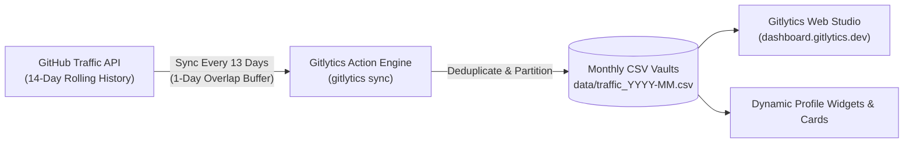

<div align="center">


# Gitlytics Traffic Sync Automation
### Automated Long-Term GitHub Traffic Backup & Historical Analytics

[](https://github.com/features/actions)
[](https://www.python.org/)
[](https://pypi.org/project/gitlytics/)
[](LICENSE)
[](https://dashboard.gitlytics.dev)
[](https://docs.gitlytics.dev)

<br/>

**Never lose your repository traffic data again.**  
GitHub automatically deletes repository traffic after 14 days. This zero-maintenance GitHub Action runs every 13 days to seamlessly capture, deduplicate, and archive views, clones, referrers, and paths into clean monthly CSV vaults.

[**Explore Live Dashboard**](https://dashboard.gitlytics.dev) • [**Core Library**](https://github.com/ameyachopade/gitlytics) • [**Read Documentation**](https://docs.gitlytics.dev) • [**Engineering Blog**](https://blog.gitlytics.dev)

<br/>

</div>

---

<div align="center">
  
</div>

---

## 🧐 Why Is Automation Essential?

> [!WARNING]
> **The 14-Day Traffic Cliff:** GitHub natively **only retains repository traffic data for the last 14 days**. After two weeks, your views, clones, top referrers, and popular paths are permanently deleted and cannot be recovered.

If you want to track repository adoption, measure the impact of product launches, or maintain complete historical analytics, you need automated snapshots.

### ⏱️ The Smart 13-Day Overlap Strategy

Running an action every day wastes GitHub Actions runner minutes. Running once a month causes data loss.

Gitlytics triggers automatically **every 13 days**:
- **0 Missed Data**: Since GitHub preserves 14 days, a 13-day schedule creates a 1-day safety overlap.
- **50%+ CI Minutes Saved**: Running ~2.3 times per month instead of 30 times saves runner quotas.
- **Smart Deduplication**: The underlying `gitlytics` sync engine automatically merges date ranges without duplicates.



---

## ✨ How It Works

1. **Trigger Engine (`.github/workflows/fetch_traffic.yml`)**:  
   Runs on a schedule (`cron: '0 17 */13 * *'`) at **17:00 UTC** every 13th day, plus supports manual execution anytime (`workflow_dispatch`).

2. **Core Sync Logic (`gitlytics>=0.7.0`)**:  
   Authenticates securely using your GitHub Personal Access Token (PAT) and queries:
   - Daily views & unique visitors
   - Git clones & unique cloners
   - Top external referring domains & counts
   - Most visited file paths
   - Cumulative star and fork counters

3. **Structured Monthly CSV Vaults (`data/`)**:  
   Data is partitioned into standardized monthly CSV files (e.g. `data/traffic_2026-06.csv`). Easy to query with Pandas, DuckDB, Excel, or visualize directly in the [Gitlytics Dashboard](https://dashboard.gitlytics.dev).

---

## ⚡ Setup Guide

Choose the setup method that best matches your workflow:

### Option A: Reusable GitHub Action (Recommended)
Add automated traffic archiving directly into any existing repository.

#### Step 1: Create a Personal Access Token (PAT)
1. Navigate to GitHub **Settings** → **Developer settings** → **Personal access tokens** → **Fine-grained tokens**.
2. Click **Generate new token**.
3. Under **Repository access**, select the repository (or repositories) you wish to monitor.
4. Under **Repository permissions**, set **Administration** to **Read-only**.
5. Generate and copy the token.

*(Alternatively, you can use a Classic PAT with the `repo` scope).*

#### Step 2: Add Token to Repository Secrets
1. In your repository, go to **Settings** → **Secrets and variables** → **Actions**.
2. Click **New repository secret**.
3. Set the name to `TRAFFIC_TOKEN` and paste your token value.

#### Step 3: Add the Workflow File
Create `.github/workflows/traffic.yml` in your repository:

```yaml
name: Gitlytics Traffic Sync

on:
  schedule:
    - cron: '0 17 */13 * *'  # Runs every 13 days
  workflow_dispatch:          # Allows manual one-click trigger

jobs:
  sync-traffic:
    runs-on: ubuntu-latest
    permissions:
      contents: write         # Required to commit CSV updates to the repository
    steps:
      - name: Checkout Repository
        uses: actions/checkout@v4

      - name: Sync Traffic Data
        uses: ameyachopade/gitlytics-traffic-monitor-automation@main
        with:
          traffic_token: ${{ secrets.TRAFFIC_TOKEN }}
          data_dir: 'data/'
          metrics: 'views clones stars forks'
```

---

### Option B: Dedicated Traffic Vault (Template Repository)
Consolidate traffic metrics for **all your repositories** into a single private repository.

1. **Use This Template**: Click **Use this template** at the top right of this repository → **Create a new repository**.
2. **Make It Private**: Set the repository visibility to **Private** to protect your analytics data.
3. **Add Secret**: Under **Settings** → **Secrets and variables** → **Actions**, add `TRAFFIC_TOKEN` with a Classic PAT (`repo` scope).
4. **Run First Sync**: Navigate to the **Actions** tab, select **Fetch GitHub Traffic**, and click **Run workflow**.

---

## ⚙️ Action Inputs Reference

| Input | Description | Required | Default |
| :--- | :--- | :---: | :--- |
| `traffic_token` | GitHub Personal Access Token (PAT) with administration read access. | **Yes** | — |
| `data_dir` | Directory path where historical monthly CSV files are saved. | No | `'data/'` |
| `metrics` | Space-separated list of metrics to capture (`views clones stars forks`). | No | `'views clones stars forks'` |

---

## 📊 Visualizing Your Data

Raw CSV files are safe and durable, but visualizing them provides instant clarity:

1. **Upload to Web Studio**: Upload your generated monthly CSV files directly to **[dashboard.gitlytics.dev](https://dashboard.gitlytics.dev)** to generate interactive charts, referral breakdowns, and visitor trends.
2. **Dynamic Profile Cards**: Display your activity across your GitHub profile using Gitlytics' **[31+ Dynamic SVG Profile Cards](https://github.com/ameyachopade/gitlytics#--ultra-modern-profile-cards--widgets)**.
3. **Python & Jupyter**: Load the CSV directly into Pandas:
   ```python
   import pandas as pd
   df = pd.read_csv("data/traffic_2026-06.csv")
   print(df.groupby("repository")[["views", "unique_visitors"]].sum())
   ```

---

## 🔗 The Gitlytics Ecosystem

- 🐍 **[Gitlytics Core Library & CLI](https://github.com/ameyachopade/gitlytics)**: Core Python SDK, CLI tools, and SVG card generators.
- 🌐 **[Live Web Dashboard](https://dashboard.gitlytics.dev)**: Real-time visual traffic analytics platform.
- 📚 **[Documentation](https://docs.gitlytics.dev)**: Complete configuration guides and API docs.
- 📝 **[Engineering Blog](https://blog.gitlytics.dev)**: Architecture breakdowns and open-source analytics insights.

---

## 🌟 Show Your Support

If this automation helped you save your GitHub traffic data, please give this repository a **⭐ Star on [GitHub](https://github.com/ameyachopade/gitlytics-traffic-monitor-automation)**!

---

## 📄 License

Distributed under the **Apache License 2.0**. See [`LICENSE`](LICENSE) for details.
