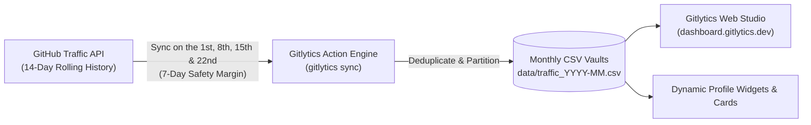

<div align="center">


# Gitlytics Traffic Sync Automation
### Automated Long-Term GitHub Traffic Backup & Historical Analytics

[](https://github.com/features/actions)
[](https://www.python.org/)
[](https://pypi.org/project/gitlytics/)
[](LICENSE)
[](https://dashboard.gitlytics.dev)
[](https://docs.gitlytics.dev)

<br/>

**Never lose your repository traffic data again.**  
GitHub automatically deletes repository traffic after 14 days. This zero-maintenance GitHub Action runs on the 1st, 8th, 15th, and 22nd of each month (a 7-day cadence) to seamlessly capture, deduplicate, and archive views, clones, referrers, and paths into clean monthly CSV vaults.

[**Explore Live Dashboard**](https://dashboard.gitlytics.dev) • [**Core Library**](https://github.com/ameyachopade/gitlytics) • [**Read Documentation**](https://docs.gitlytics.dev) • [**Engineering Blog**](https://blog.gitlytics.dev)

<br/>

</div>

---

<div align="center">
  
</div>

---

## 🧐 Why Is Automation Essential?

> [!WARNING]
> **The 14-Day Traffic Cliff:** GitHub natively **only retains repository traffic data for the last 14 days**. After two weeks, your views, clones, top referrers, and popular paths are permanently deleted and cannot be recovered.

If you want to track repository adoption, measure the impact of product launches, or maintain complete historical analytics, you need automated snapshots.

### ⏱️ The Smart 7-Day Overlap Strategy

Running an action every day wastes GitHub Actions runner minutes. Running once a month causes data loss.

Gitlytics triggers automatically on the **1st, 8th, 15th, and 22nd of each month** (a 7-day cadence):
- **0 Missed Data**: GitHub preserves 14 days, so the schedule leaves a 7-day safety margin - one failed or scheduler-delayed run cannot lose traffic (AF2-ACT-06).
- **80%+ CI Minutes Saved**: Running 4 times per month instead of 30 times saves runner quotas.
- **Smart Deduplication**: The underlying `gitlytics` sync engine automatically merges date ranges without duplicates.



---

## ✨ How It Works

1. **Trigger Engine (`.github/workflows/fetch_traffic.yml`)**:  
   Runs on a schedule (`cron: '0 17 1,8,15,22 * *'`) at **17:00 UTC on the 1st, 8th, 15th, and 22nd of each month**, plus supports manual execution anytime (`workflow_dispatch`).

2. **Core Sync Logic (`gitlytics==0.7.2`)**:  
   Authenticates securely using your GitHub Personal Access Token (PAT) and queries:
   - Daily views & unique visitors
   - Git clones & unique cloners
   - Top external referring domains & counts
   - Most visited file paths
   - Cumulative star and fork counters

3. **Structured Monthly CSV Vaults (`data/`)**:  
   Data is partitioned into standardized monthly CSV files (e.g. `data/traffic_2026-06.csv`). Easy to query with Pandas, DuckDB, Excel, or visualize directly in the [Gitlytics Dashboard](https://dashboard.gitlytics.dev).

---

## ⚡ Setup Guide

Choose the setup method that best matches your workflow:

### Option A: Reusable GitHub Action (Recommended)
Add automated traffic archiving directly into any existing repository.

#### Step 1: Create a Personal Access Token (PAT)
1. Navigate to GitHub **Settings** → **Developer settings** → **Personal access tokens** → **Fine-grained tokens**.
2. Click **Generate new token**.
3. Under **Repository access**, select the repository (or repositories) you wish to monitor.
4. Under **Repository permissions**, set **Administration** to **Read** and **Metadata** to **Read**.
   GitHub's traffic endpoints require the fine-grained permission set `"Administration" repository permissions (read)` - a read grant is enough, and a write grant would hand this scheduled action destructive repository-admin powers (rename, transfer, delete) that it never uses.
5. Generate and copy the token. The token owner must be an administrator or collaborator on the repository.

*(Alternatively, you can use a Classic PAT with the `repo` scope. That scope also carries write access to the selected private repositories.)*

#### Step 2: Add Token to Repository Secrets
1. In your repository, go to **Settings** → **Secrets and variables** → **Actions**.
2. Click **New repository secret**.
3. Set the name to `TRAFFIC_TOKEN` and paste your token value.

#### Step 3: Add the Workflow File
Create `.github/workflows/traffic.yml` in your repository:

```yaml
name: Gitlytics Traffic Sync

on:
  schedule:
    - cron: '0 17 1,8,15,22 * *'  # 1st, 8th, 15th and 22nd at 17:00 UTC
  workflow_dispatch:            # Allows manual one-click trigger

jobs:
  sync-traffic:
    runs-on: ubuntu-latest
    timeout-minutes: 30
    permissions:
      contents: write           # Required to commit CSV updates to the repository
    steps:
      - name: Checkout Repository
        uses: actions/checkout@11bd71901bbe5b1630ceea73d27597364c9af683 # v4.2.2

      - name: Sync Traffic Data
        id: gitlytics
        uses: ameyachopade/gitlytics-github-traffic-automation@v1.2.0
        with:
          traffic_token: ${{ secrets.TRAFFIC_TOKEN }}
          data_dir: 'data/'
          # Optional. Defaults to the current repository.
          # repository: 'owner/repo' # or 'owner/r1, owner/r2' or 'all'
          # branch: 'traffic-vault'
          # metrics: 'views clones referrers paths stars forks releases'

      - name: Report archive result
        # Never interpolate an expression directly into a `run:` body - GitHub
        # substitutes it into the SCRIPT TEXT before bash parses it. Pass it
        # through `env:` and quote it instead.
        env:
          ROWS_CHANGED: ${{ steps.gitlytics.outputs.changed }}
        run: echo "New rows committed: ${ROWS_CHANGED:-false}"
```

> [!IMPORTANT]
> `actions/checkout` must run before this action. Without a work tree the action cannot commit the CSV vault and fails with an explicit error.

---

### Option B: Dedicated Traffic Vault (Template Repository)
Consolidate traffic metrics for **all your repositories** into a single private repository.

1. **Use This Template**: Click **Use this template** at the top right of this repository → **Create a new repository**.
2. **Make It Private**: Set the repository visibility to **Private** to protect your analytics data.
3. **Add Secret**: Under **Settings** → **Secrets and variables** → **Actions**, add `TRAFFIC_TOKEN` using a Classic PAT (`repo` scope) or a fine-grained PAT with **Administration: Read** plus **Metadata: Read**.
4. **Run First Sync**: Navigate to the **Actions** tab, select **Fetch GitHub Traffic**, and click **Run workflow**. The included `.github/workflows/fetch_traffic.yml` sets `repository: 'all'` so your vault archives all accessible **public** repositories out of the box.

> [!IMPORTANT]
> **Private repositories are opt-in.** With `repository: 'all'`, only public repositories are archived unless you set `include_private: 'true'`. If you enable it, the committed CSVs will contain your private repository names and traffic metrics - keep the vault repository private.

> [!NOTE]
> **Pin a release tag, not a branch.** Reference the action as `@v1.2.0` (or a 40-character commit SHA). A moving branch is not a stable contract.

---

## ⚙️ Action Inputs Reference

| Input | Description | Required | Default |
| :--- | :--- | :---: | :--- |
| `traffic_token` | GitHub Personal Access Token (PAT). Fine-grained tokens need **Administration: Read** + **Metadata: Read**; classic tokens need the `repo` scope. | **Yes** | - |
| `repository` | Repository to back up as `owner/repo`, a comma-separated list (`owner/r1, owner/r2`), or `all` for every repository the token can read. Specific repos also drive per-repo permission preflight. | No | current repository (Option B template sets `'all'`) |
| `data_dir` | Relative directory path where historical monthly CSV files are saved. | No | `'data/'` |
| `metrics` | Space-separated list of metrics to capture. Dropping `referrers` or `paths` permanently loses that data after GitHub's 14-day window. Using the default preserves all repository metadata columns as well. | No | `'views clones referrers paths stars forks releases'` |
| `branch` | Branch to commit and push traffic data to. | No | current branch |
| `include_private` | When `repository` is `all`, set to `'true'` to archive private repositories too. The default `'false'` keeps private repository names and their traffic out of the committed CSV vault (AF2-ACT-08). Explicit `owner/repo` entries are always archived. | No | `'false'` |

### Action Outputs

| Output | Description |
| :--- | :--- |
| `changed` | `true` when new traffic rows were committed and pushed, `false` when the vault was already current. |
| `data_dir` | Directory containing the archived traffic CSV files. |

---

## 📊 Visualizing Your Data

Raw CSV files are safe and durable, but visualizing them provides instant clarity:

1. **Upload to Web Studio**: Upload your generated monthly CSV files directly to **[dashboard.gitlytics.dev](https://dashboard.gitlytics.dev)** to generate interactive charts, referral breakdowns, and visitor trends.
2. **Dynamic Profile Cards**: Display your activity across your GitHub profile using Gitlytics' **[31+ Dynamic SVG Profile Cards](https://github.com/ameyachopade/gitlytics#--ultra-modern-profile-cards--widgets)**.
3. **Python & Jupyter**: Load the CSV directly into Pandas:
   ```python
   import pandas as pd
   df = pd.read_csv("data/traffic_2026-06.csv")
   print(df.groupby("repository")[["views", "unique_visitors"]].sum())
   ```

---

## 🔗 The Gitlytics Ecosystem

- 🐍 **[Gitlytics Core Library & CLI](https://github.com/ameyachopade/gitlytics)**: Core Python SDK, CLI tools, and SVG card generators.
- 🌐 **[Live Web Dashboard](https://dashboard.gitlytics.dev)**: Real-time visual traffic analytics platform.
- 📚 **[Documentation](https://docs.gitlytics.dev)**: Complete configuration guides and API docs.
- 📝 **[Engineering Blog](https://blog.gitlytics.dev)**: Architecture breakdowns and open-source analytics insights.

---

## 🌟 Show Your Support

If this automation helped you save your GitHub traffic data, please give this repository a **⭐ Star on [GitHub](https://github.com/ameyachopade/gitlytics-github-traffic-automation)**!

---

## 📄 License

Distributed under the **Apache License 2.0**. See [`LICENSE`](LICENSE) for details.
